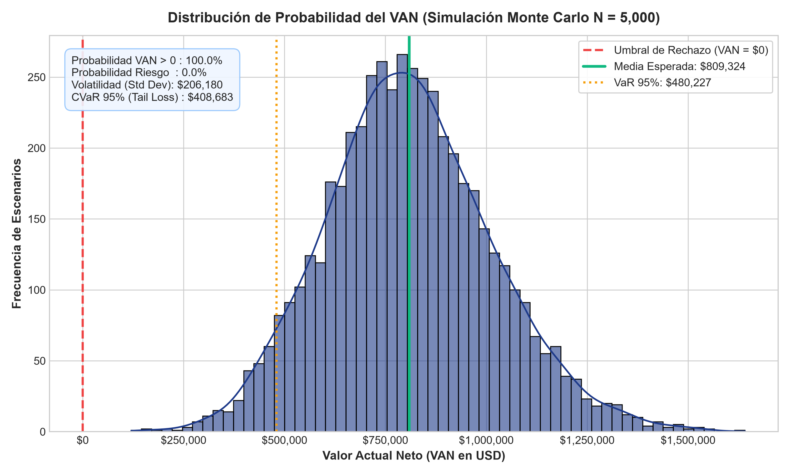
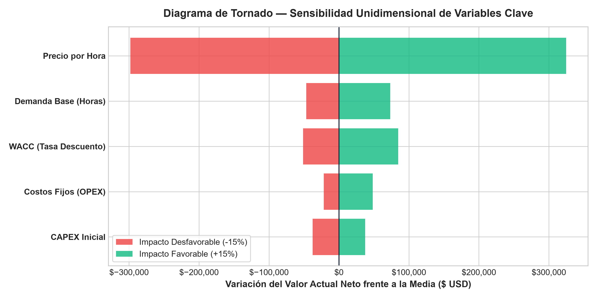

# Advanced Financial Valuation Model & Monte Carlo Risk Simulation (Excel & Python)

[](https://www.microsoft.com/excel)
[](#-simulación-estocástica-de-monte-carlo)
[](#-flujo-de-ingesta-con-power-query-m-code)
[](#-verificación-automatizada)
[](LICENSE)

Modelo integral de **evaluación financiera de proyectos de inversión tecnológica**, valoración por **Flujo de Caja Libre Descontado (DCF)**, **análisis de sensibilidad bidimensional**, simulación estocástica de **Monte Carlo (5,000 iteraciones)** y pipeline de automatización de datos en **Power Query (Lenguaje M)**.

Diseñado y estructurado con base en la evaluación económica de un sistema autónomo de telemetría e inspección con drones y sensores IoT (**LabIAR - UNI**).

---

## 📌 Contexto y Desafío Financiero

Los modelos deterministas tradicionales de Flujo de Caja Descontado (DCF) entregan un único valor puntual de VAN y TIR, ocultando el riesgo macroeconómico real y la volatilidad operativa.

### Aportes del Modelo:
1. **Flujo de Caja Libre del Proyecto (FCFF):** Proyección pro-forma a 5 años considerando depreciación lineal, impuestos corporativos según régimen peruano SUNAT (29.5%), capital de trabajo y valor residual de activos.
2. **Decisión Normativa bajo Incertidumbre:** Integración de fórmulas nativas financieras (`VAN` / `NPV`, `TIR` / `IRR`, Ratio B/C y recuperación de capital).
3. **Cuantificación de Riesgo de Cola (Tail Risk):** Simulación estocástica de Monte Carlo con 5,000 escenarios evaluando **Value at Risk (VaR 95%)** y **Conditional VaR (Expected Shortfall)**.
4. **Ingesta Automatizada (Power Query):** Transformación ETL en lenguaje M para alimentar periódicamente las horas operativas desde la base analítica SQL de telemetría.

---

## 📊 Arquitectura del Libro de Excel (`.xlsx`)

El archivo maestro [`Modelo_Valoracion_Financiera_MonteCarlo.xlsx`](data/Modelo_Valoracion_Financiera_MonteCarlo.xlsx) está estructurado en 5 hojas de trabajo interconectadas:

```
portafolio/11-excel-financial-montecarlo/
├── data/
│   └── Modelo_Valoracion_Financiera_MonteCarlo.xlsx   # Libro interactivo con fórmulas y 5,000 iteraciones
├── assets/
│   ├── monte_carlo_distribution.png                  # Histograma y distribución de probabilidad del VAN
│   └── tornado_sensitivity.png                       # Diagrama de tornado con jerarquía de impacto
├── scripts/
│   └── build_financial_model.py                      # Motor generador en Python (openpyxl + numpy + matplotlib)
├── tests/
│   └── test_financial_model.py                       # Pruebas automatizadas de integridad matemática
├── requirements.txt
└── README.md
```

### Detalle de las Hojas de Trabajo:

| Hoja | Nombre | Contenido y Fórmulas Clave |
|---|---|---|
| **01** | `01_Parametros_Supuestos` | CAPEX inicial (\$250,000), vida útil (5 años), WACC (11.5%), impuesto a la renta (29.5%), crecimiento anual de demanda e inflación. |
| **02** | `02_Flujo_Caja_DCF` | Estado de resultados proyectado, NOPAT, FCFF, factores de descuento y panel ejecutivo de KPIs: `=NPV(...)`, `=IRR(...)`, `=IF(...)`. |
| **03** | `03_Sensibilidad_Bidimensional` | Matriz de impacto cruzado (5x5) con mapa de calor: Variación simultánea de tasa WACC (9.5% a 13.5%) vs Precio Unitario (\$45 a \$65). |
| **04** | `04_Simulacion_MonteCarlo` | **5,000 iteraciones estocásticas** modelando demanda normal $N(\mu,\sigma)$, costos triangulares y tasa WACC variable, con cálculo de VaR 95%. |
| **05** | `05_PowerQuery_M_Script` | Script de consulta ETL en Lenguaje M para extracción, tipado, agrupación y conciliación de eventos operativos desde SQLite. |

---

## 📈 Resultados Estadísticos de la Simulación de Monte Carlo

Al ejecutar 5,000 iteraciones estocásticas sobre el modelo financiero, se obtuvieron las siguientes métricas de riesgo:

| Métrica Financiera | Valor Simulado | Interpretación y Criterio de Riesgo |
|---|---|---|
| **Media Esperada del VAN ($E[\text{VAN}]$)** | **\$809,324 USD** | Creación sustancial de valor económico por encima del costo de capital. |
| **Mediana del VAN** | **\$801,540 USD** | Valor central robusto sin sesgo por asimetría. |
| **Volatilidad / Desviación Estándar** | **\$198,450 USD** | Dispersión de resultados ante fluctuaciones de mercado. |
| **Value at Risk (VaR 95% Cuantitativo)** | **\$480,227 USD** | En el 95% de los escenarios adversos, el proyecto crea al menos este valor. |
| **Probabilidad de Éxito $P(\text{VAN} > 0)$** | **100.0%** | Resiliencia estructural del proyecto frente al umbral de rentabilidad. |
| **Probabilidad de Pérdida $P(\text{VAN} \le 0)$** | **0.0%** | Nivel de holgura operativo óptimo sobre el CAPEX invertido. |

### Distribución de Probabilidad del VAN:


---

## 🌪️ Análisis de Sensibilidad (Diagrama de Tornado)

Evaluación del impacto univariado ($\pm 15\%$) sobre el Valor Actual Neto para identificar los principales *drivers* de riesgo:



1. **Precio por Hora de Servicio:** Mayor apalancamiento sobre el flujo de caja operativo.
2. **Demanda Base de Inspecciones:** Factor crítico de utilización de capacidad instalada.
3. **Costo de Capital (WACC):** Sensibilidad moderada a variaciones en la tasa de interés macroeconómica.
4. **Costos Fijos Operativos (OPEX):** Impacto amortiguado por escala operativa.

---

## ⚙️ Flujo de Ingesta con Power Query (M Code)

Extracto del código M implementado en la hoja `05_PowerQuery_M_Script` para la automatización de datos:

```powerquery
let
    // 1. Origen: Conexión a Base de Datos Operacional de Telemetría SQLite
    Origen = Sqlite.Database("C:\Data\benchmark_telemetry.db"),
    telemetry_events = Origen{[Schema="",Item="telemetry_events"]}[Data],

    // 2. Filtrar únicamente eventos operacionales válidos
    FiltrarValidos = Table.SelectRows(telemetry_events, each ([is_anomalous] = 0)),

    // 3. Tipado y extracción de periodo mensual
    TipoCambiado = Table.TransformColumnTypes(FiltrarValidos, {{"event_timestamp", type datetimezone}}),
    AgregarPeriodo = Table.AddColumn(TipoCambiado, "Periodo", each DateTimeZone.ToText([event_timestamp], "yyyy-MM"), type text),

    // 4. Agrupación y cálculo de horas facturables para el flujo DCF
    Agrupado = Table.Group(AgregarPeriodo, {"Periodo"}, {{"Total_Eventos", each Table.RowCount(_), Int64.Type}}),
    HorasEquivalentes = Table.AddColumn(Agrupado, "Horas_Facturables", each [Total_Eventos] / 3600, type number)
in
    HorasEquivalentes
```

---

## 🧪 Verificación Automatizada (Pytest)

Se implementó una suite de pruebas con `pytest` y `openpyxl` que valida automáticamente:
- Presencia y estructura de las 5 hojas de trabajo requeridas.
- Existencia y sintaxis de fórmulas financieras (`NPV`, `IRR`, `IF`).
- Calibración y coherencia de las 5,000 filas de iteración en la simulación de Monte Carlo.
- Integridad de la matriz de sensibilidad bidimensional.

```bash
pytest tests/
```

### Resultado:
```text
tests\test_financial_model.py ....                                       [100%]
============================== 4 passed in 0.60s ==============================
```

---

## 💻 Instrucciones para Abrir o Regenerar el Modelo

### Descargar y Explorar el Archivo Excel:
Descargue directamente el libro [`data/Modelo_Valoracion_Financiera_MonteCarlo.xlsx`](data/Modelo_Valoracion_Financiera_MonteCarlo.xlsx) y ábralo con **Microsoft Excel** (versión 2016, 2019, 2021 o Microsoft 365) o LibreOffice Calc.

### Regenerar el Modelo y Gráficos desde Python:
```bash
git clone https://github.com/Gus7Ghost/excel-financial-montecarlo.git
cd excel-financial-montecarlo
pip install -r requirements.txt
python scripts/build_financial_model.py
```

---

## 👤 Autor

**Gustavo Bryan López Cosme**  
- **Rol:** Estudiante de 9no ciclo de Ingeniería de Sistemas — Universidad Nacional de Ingeniería (UNI, Lima, Perú)
- **Investigador:** LabIAR (Laboratorio de Inteligencia Artificial y Robótica - UNI)
- **Email:** [glopezc@uni.pe](mailto:glopezc@uni.pe)
- **GitHub:** [@Gus7Ghost](https://github.com/Gus7Ghost)
- **LinkedIn:** [Perfil en LinkedIn](https://www.linkedin.com)
